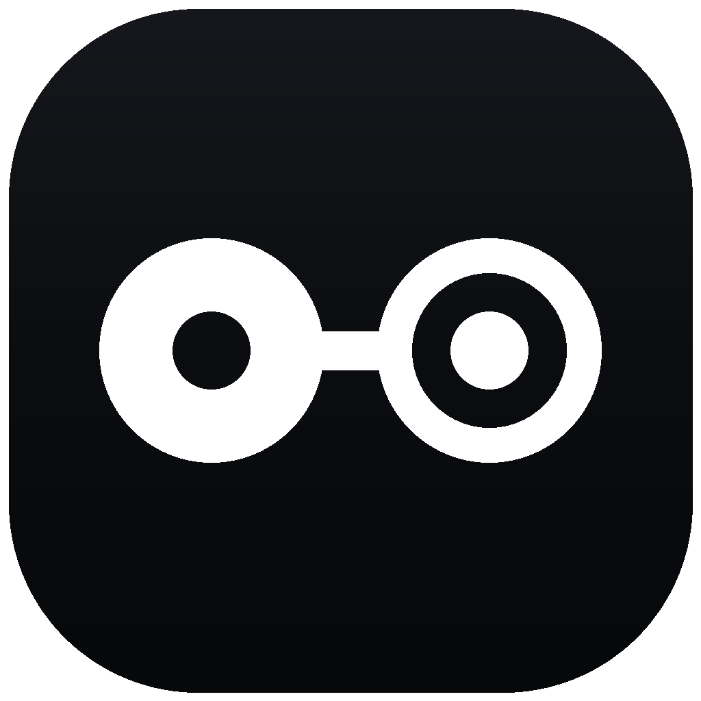
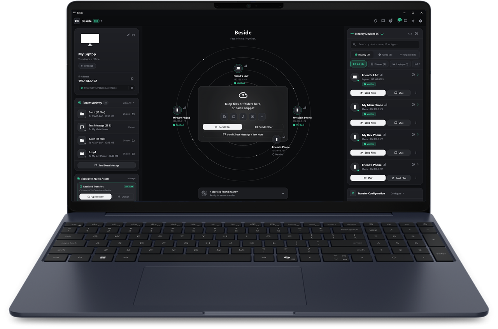

<p align="center">
  
</p>

<h1 align="center">Beside for Windows</h1>

<p align="center">
  <strong>Fast Private Together</strong><br>
  <em>Send it. It's there. — Direct local-first peer-to-peer file, folder, and text sharing between Windows and Android over Wi-Fi.<br>Mutual TLS 1.3, zero cloud, zero accounts, flat 64 KB RAM bounded streaming.</em>
</p>

<p align="center">
  <a href="https://beside-license-worker.khthisald.workers.dev"></a>
  <a href="https://thisma-labs.github.io/beside-windows-support"></a>
  <a href="https://github.com/thisma-labs/beside-android-support"></a>
  <a href="https://github.com/thisma-labs/beside/releases/latest"></a>
  
  
</p>

<p align="center">
  <picture>
    <source media="(prefers-color-scheme: dark)" srcset="assets/laptop-hero-opt.png">
    <source media="(prefers-color-scheme: light)" srcset="assets/laptop-hero-light-opt.png">
    
  </picture>
</p>

---

## Overview

**Beside for Windows** is a standalone, dedicated desktop application built for Windows 10 and Windows 11 (64-bit x64). Engineered with a high-performance Flutter desktop UI and an ultra-secure native Rust core (`rustls` + `ring` + `mdns-sd`), Beside streams data directly machine-to-machine across your local Wi-Fi subnet at wire speed without intermediate cloud relays, storage quotas, or user registration.

### The 3-Column Desktop Architecture

- **Left Column — Identity & Shortcuts**: Displays your local device identity ("Thisma-PC"), pinned SPKI fingerprint with one-click copy, quick system shortcuts (Downloads, Desktop, Pictures), and active Mutual TLS 1.3 status.
- **Center Column — Concentric Radar & Dropzone**: Live zero-configuration mDNS radar displaying orbiting nearby peers, a frosted drag-and-drop target zone, and rapid category filters (Files, Folders, Clipboard Text).
- **Right Column — Discovered Peers & Transfer Queue**: Comprehensive list of detected local machines, active transfer progress docks, and a 60-second pending request queue for incoming transfers.

---

## Windows Native Operating System Integrations

Beside is engineered to feel like an integral part of Windows:

| Integration | Capabilities & User Experience |
| :--- | :--- |
| **System Tray Mode** | Runs unobtrusively in the Windows taskbar notification area. Right-click context menu lets you pause receiving, toggle auto-accept, send files, or open settings. Optional first-run consent to start minimized with Windows. |
| **Explorer Context Menu** | Right-click any file or directory in Windows File Explorer and select **"Send with Beside"** to dispatch immediately. If multiple peers are online, a compact target picker appears. |
| **SendTo Menu** | Integrates into the classic Windows `shell:sendto` menu for rapid keyboard and Explorer dispatches. |
| **WinRT Toast Notifications** | Interactive native desktop notifications with direct action buttons: **Accept**, **Decline**, **Copy text**, and **Open folder**. Includes an optional privacy toggle to hide message previews. |
| **File Explorer Reveal** | Completed transfers invoke native Win32 shell API (`SHOpenFolderAndSelectItems`) to automatically highlight received files in Explorer. |
| **Hardware Key Vault** | Device identity private keys are encrypted at rest using the **Windows Data Protection API (DPAPI)** bound to your Windows user logon credentials. |

---

## Free vs. Pro Edition Matrix

| Feature | Beside Free ($0 Forever) | Beside Pro ($14.99 USD Lifetime &bull; 3 Devices) |
| :--- | :---: | :---: |
| **Pricing** | Free Forever ($0) | $14.99 One-Time Lifetime Purchase |
| **Personal Devices Covered** | 1 Device | Up to 3 Personal Devices |
| **Max Outgoing File Size** | 1 MB per transfer | **Unlimited** (Bounded 64 KB RAM streaming) |
| **Batch Transfers & Folders** | 1 File per transfer | **Unlimited** files & full directory trees |
| **Direct LAN Text Messaging** | Up to 40 characters | **Full-length** messages up to 1 MB |
| **Paired Peers in TrustStore** | 1 Paired Peer | **Unlimited** Pinned Peers |
| **Zero-Click Auto-Accept** | Disabled | **Enabled** (Opt-in toggle for trusted peers) |
| **Receiving from Pro Senders** | **Unlimited & Free Forever** | **Unlimited & Free Forever** |
| **Windows Integrations (Tray, Toasts, Shell)** | **Full Access Included** | **Full Access Included** |

---

## Downloads & Verification (Windows v0.1.1)

| Package | Format | Size | Checksum (SHA-256) | Download |
| :--- | :---: | :---: | :---: | :---: |
| **Setup Installer (Recommended)** | `.exe` | 12.12 MB | `8b8a4aa83215c08481ad3bb92fe0f2c44dddaefef08a48175f8e367e9dc5e1d3` | [**Download Beside-Setup-v0.1.1-x64.exe**](https://github.com/thisma-labs/beside/releases/download/v0.1.1/Beside-Setup-v0.1.1-x64.exe) |
| **Portable ZIP Archive** | `.zip` | 14.02 MB | `e521df7e120853d5ca4d71cd7069c19e080c0e8b28728671fd73394c6c36b3ba` | [**Download Beside-v0.1.1-Windows-x64.zip**](https://github.com/thisma-labs/beside/releases/download/v0.1.1/Beside-v0.1.1-Windows-x64.zip) |

### Verifying Checksums in PowerShell

```powershell
Get-FileHash -Algorithm SHA256 Beside-Setup-v0.1.1-x64.exe
# Expected: 8b8a4aa83215c08481ad3bb92fe0f2c44dddaefef08a48175f8e367e9dc5e1d3
```

---

## System Requirements

- **Operating System**: Windows 10 (version 1809+, build 17763+) or Windows 11 (64-bit x64).
- **Architecture**: 64-bit (x86_64).
- **Network**: Wi-Fi, Ethernet, or mobile hotspot with local IP connectivity between devices.
- **Firewall**: Inbound TCP rule for Beside.exe (configured automatically by the Inno Setup installer).

---

## Official Storefronts & Links

- **Official Website**: [https://beside-license-worker.khthisald.workers.dev](https://beside-license-worker.khthisald.workers.dev)
- **Windows Support Portal**: [https://thisma-labs.github.io/beside-windows-support](https://thisma-labs.github.io/beside-windows-support)
- **Android Support Portal**: [https://github.com/thisma-labs/beside-android-support](https://github.com/thisma-labs/beside-android-support)
- **Buy Beside Pro Lifetime**: [https://thismalabs.gumroad.com/l/beside-pro](https://thismalabs.gumroad.com/l/beside-pro)
- **itch.io Community**: [https://thisma-labs.itch.io/beside](https://thisma-labs.itch.io/beside)
- **SourceForge Mirror**: [https://sourceforge.net/projects/beside-app](https://sourceforge.net/projects/beside-app)
- **GitHub Issues**: [https://github.com/thisma-labs/beside/issues](https://github.com/thisma-labs/beside/issues)
